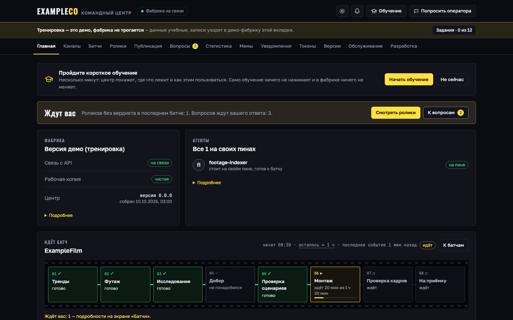
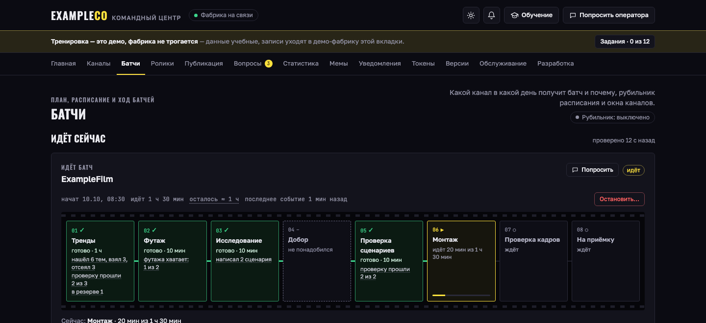
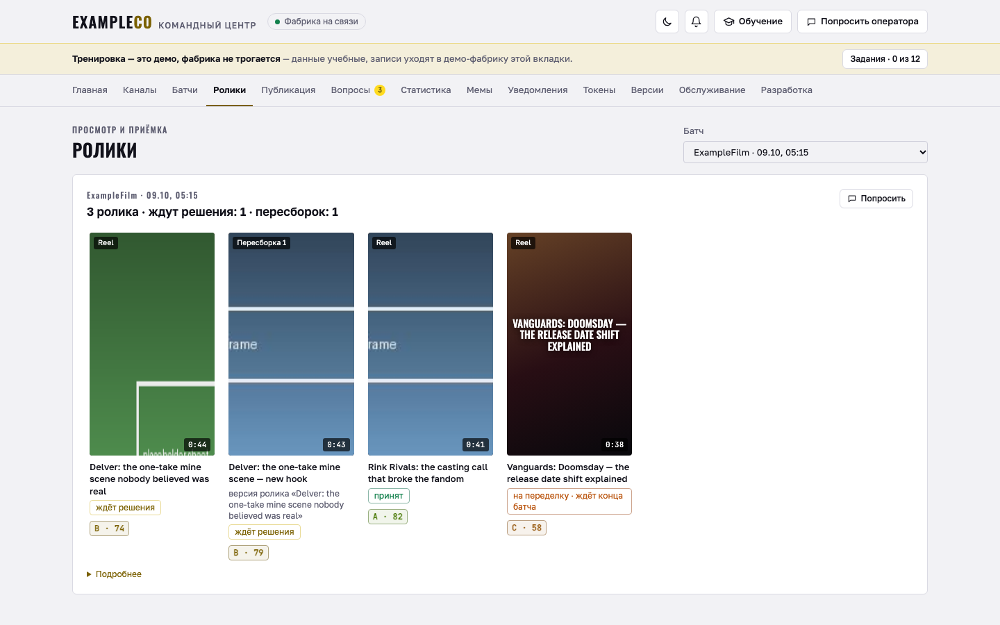
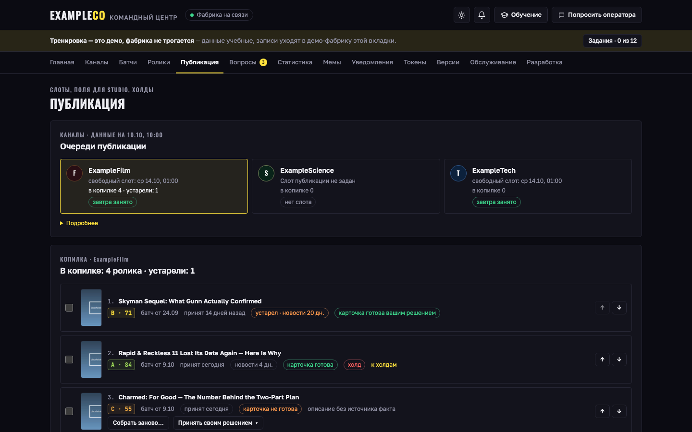
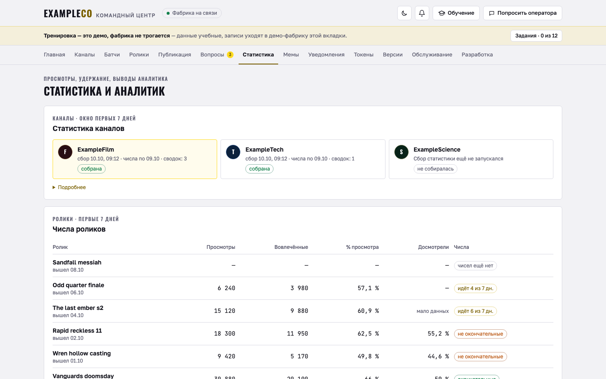
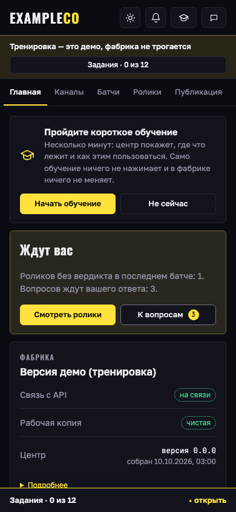

# Command Center

A web control panel for an automated short-video pipeline: it shows what the pipeline is doing, lets a human review and accept finished videos, manages the publishing queue and the batch schedule, and edits per-channel settings.

> **Portfolio snapshot.** This is the front end of a private project, published to show how it is built. The backend (a FastAPI service that drives the pipeline) is **not** part of this repository. The live demo and the unit/e2e tests run on an in-browser mock API ([MSW](https://mswjs.io/)) with invented data: a made-up media company ("ExampleCo"), made-up channels, titles and numbers, generated placeholder images. Nothing here talks to a real service, and no real accounts, channels or media are included.

**Live demo:** https://hitsudzy.github.io/command-center-showcase/ (runs entirely in your browser on mock data; no login)

**UI language: Russian.** Screens, labels and help texts are in Russian; code identifiers and most comments are English or Russian.



## What it is

The pipeline (private) turns topics into finished vertical videos in **batches**: a batch is one pass over a fixed chain of stages (trends, footage, research, script check, edit, frame check, acceptance). Command Center is the human side of that pipeline. It has 13 areas, one tab each:

| Area                            | What the screen does                                                                                                                                                                                                                       |
| ------------------------------- | ------------------------------------------------------------------------------------------------------------------------------------------------------------------------------------------------------------------------------------------ |
| **Главная** (Overview)          | Version of the pipeline and agents, API link status, the running batch drawn as a film strip of stages, an "attention" strip (videos without a verdict, open questions), upcoming publications, a short interactive tour.                  |
| **Каналы** (Channels)           | Channel list with schedule window, pause and next publication; per-channel settings form, raw JSON editor with live validation, row editors for lists (fact sources, footage origin, affiliate links), edit history, "new channel" wizard. |
| **Батчи** (Batches)             | Day plan and weekly schedule, launch / stop / resume / re-run-from-a-stage, stage-by-stage progress with the stage logs and a funnel summary, topics of the running batch, stranded (failed) batches, run history.                         |
| **Ролики** (Videos)             | Review and acceptance of finished videos: player, cover, score breakdown, compare versions, verdicts (accept / rebuild / reject) with a reason, rebuild and replace flows.                                                                 |
| **Публикация** (Publishing)     | Publish queue as a feed of dated slots, a "stash" of accepted-but-unscheduled videos, a card with copy-able fields for the upload form, pause and API-upload switches, holds, moving videos between slots.                                 |
| **Вопросы** (Questions)         | Questions the pipeline asks a human and the requests the human sends back ("ask the operator"); answer, resolve, history.                                                                                                                  |
| **Статистика** (Statistics)     | Per-channel view metrics for the first days after release, per-video charts, the analyst's summary, wanted-footage hints, entry of figures read from the creator dashboard.                                                                |
| **Мемы** (Memes)                | Meme bank of a channel: review new candidates (keep / drop), add images and GIFs, trim and cut-out jobs.                                                                                                                                   |
| **Уведомления** (Notifications) | Delivery journal, reminders, a test send.                                                                                                                                                                                                  |
| **Токены** (Tokens)             | State and expiry of the upload token, OAuth permissions, API data and its purge.                                                                                                                                                           |
| **Версии** (Versions)           | Pipeline, agent and UI versions against their pins.                                                                                                                                                                                        |
| **Обслуживание** (Maintenance)  | Token spend per stage, comparison of runs, cleanup and archive actions.                                                                                                                                                                    |
| **Разработка** (Development)    | Read-only view of the project's task list and roadmap (milestones, filters, task card).                                                                                                                                                    |

Writes that change something follow one pattern: the UI asks the API for a **plan** (what would happen), shows it in a confirm dialog, and sends the confirmation **with a short-lived token** from the plan; an expired or changed plan is refused and re-planned. While any write is in flight a global write lock freezes the UI, and when the API is read-only the write buttons are disabled with the reason.

|                                                        |                                                                 |
| ------------------------------------------------------ | --------------------------------------------------------------- |
|        |     |
|  |  |

Phone layout (390 px wide):



Dark is the default theme; the light one is a toggle in the header (the choice is kept in `localStorage`). The layout is responsive (breakpoints at 640 and 900 px).

## The demo (mock-data mode)

The app already contains a built-in "training" mode: a fake pipeline runs inside the browser, so people can practise acceptance, publishing and other writes without touching the real one. The public demo is a build in which that mode is always on:

- `npm run build:demo` runs `vite build --mode demo`, which reads `.env.demo` (`VITE_DEMO=1`, base path `/command-center-showcase/` for a GitHub Pages project site).
- On start the app registers an MSW **service worker** (`public/mockServiceWorker.js`) and loads the mock server as a lazy chunk; every `/api/...` request is answered in the browser by the same mocks the unit tests use (`src/mocks/`), with state, so confirmations, refusals and expired plans behave realistically. A guard refuses to send any `/api` request if the worker is not controlling the page.
- The sign-in step is skipped in the demo (the real app has a password screen for access from a home network). No password or secret is shipped.
- The banner under the header says it is a demo; the "Задания" panel lists 12 things to try (accept a video, pause a channel, confirm an expired plan, …). "Exit training" is hidden because there is no real API to return to.
- Routing uses the History API with a `base`; the build copies `index.html` to `404.html` so deep links such as `/command-center-showcase/batches` work on GitHub Pages.
- The demo is deployed by pushing the built `dist/` to the `gh-pages` branch (_Settings → Pages → Deploy from a branch → gh-pages_).

## Tech stack

From `package.json`:

- **React 19**, **TypeScript 6** (strict), **Vite 8**, **React Router 8**
- **TanStack Query 5** for server state, **openapi-fetch** for the typed API client
- **Tailwind CSS 4**, shadcn/ui-style components on **Radix UI** primitives, `class-variance-authority`
- **CodeMirror 6** (JSON editor with linting), `jsonc-parser`
- Fonts bundled with `@fontsource` (Oswald, Golos Text, JetBrains Mono), no network at runtime
- **Vitest 5** + Testing Library + jsdom, **MSW 2**, **Playwright**
- ESLint 10 (typescript-eslint, react-hooks), Prettier 3

## Architecture notes

```
src/
  app/         router (13 areas), layout and header, theme, QueryClient
  api/         typed client + TanStack Query hooks per domain; schema.gen.ts is generated
  auth/        sign-in gate and login screen (bypassed in the demo)
  pages/       one folder per area; each area is its own lazy route chunk
  components/  ui/ (Radix-based primitives), common/ (cards, states, confirm dialogs), shell/, ask/, studio/
  mocks/       in-memory mock backends with state, shared by unit tests, e2e and the demo
  training/    in-browser demo server (lazy), task checklist, banner and panel
  tour/        guided tour engine
tests/e2e/     Playwright specs
scripts/       api-contract check/generation, lazy-chunk guard, test helpers
```

- **Typed API client generated from OpenAPI.** `src/api/openapi.snapshot.json` is a copy of the backend's OpenAPI contract (v0.79.0, 186 paths, 198 operations). `npm run api:types` generates `schema.gen.ts` and `contract.gen.ts` from it; `npm run api:check` (part of `typecheck`) and the build fail if the generated files no longer match the snapshot. If you set `CC_OPENAPI=<path to openapi.json>` the check also compares against a live contract file. `dist/contract.json` records which contract a build was made for.
- **Mocks as the single source of fixtures.** Each backend area has a mock (`createXBackend` + `routeX`) with state. The same mocks serve Vitest (`msw/node`, unhandled requests fail the test), Playwright (requests are intercepted, anything leaving the local server fails the test) and the browser demo.
- **Code splitting.** Every area is a lazy route; the JSON editor and the demo server are separate chunks. A build plugin (`trainingLazy`, tested in `scripts/lazy-chunks.test.ts`) fails the build if demo or mock code leaks into a non-lazy chunk.
- **Plan / confirm writes** with expiring tokens, a global write lock and read-only mode (see above), implemented once in shared hooks and dialogs.
- **UI rules for non-programmers:** technical ids, paths and raw server lines are hidden under a "Подробнее" (details) disclosure; tooltips explain statuses; destructive actions need confirmation. The visual design notes are in [`docs/design.md`](docs/design.md) (in Russian).

## Run it

Requires Node from `.nvmrc` (26.7.0; `engines` in `package.json`).

```sh
npm ci
npm run dev:demo      # dev server on http://127.0.0.1:5173 with the mock API in the browser
npm run build:demo    # production demo build into dist/ (base /command-center-showcase/, 404.html fallback)
npm run preview:demo  # serve that build at http://127.0.0.1:4173/command-center-showcase/
```

Other scripts: `npm test` (Vitest), `npm run e2e` (Playwright; first `npx playwright install chromium`), `npm run lint`, `npm run typecheck`, `npm run api:types`.

`npm run dev` / `npm run build` (without `:demo`) build the app as it is meant to run against the real backend: the dev server proxies `/api` to `CC_API_URL` (default `http://127.0.0.1:8790`, see `.env.example`) and the sign-in screen is active. That backend is private, so these two modes are not usable from this repository alone.

## Tests

Counted at the time of this snapshot (2026-11-16):

- **Unit/component tests (Vitest, jsdom + MSW):** 159 files, **1280 tests**, all passing.
- **End-to-end tests (Playwright, Chromium, against a built app with intercepted `/api`):** 75 spec files, **470 tests**, all passing (5.3 min on a laptop with 4 workers).
- `npm run typecheck`, ESLint (`--max-warnings 0`) and Prettier checks pass.

## Notes on this snapshot

- Source comments and commit-era task ids (`CC-0123`) were kept as they were; many comments are in Russian.
- Some unit and e2e expectations were updated to the replacement mock data (names, row counts, the length of the placeholder clip); no tests were deleted. Some modules of the original (for example rights and licence handling screens) were removed or simplified before publication.
- Version of the UI at the time of the snapshot: 1.1.17.

## License

[MIT](LICENSE)
